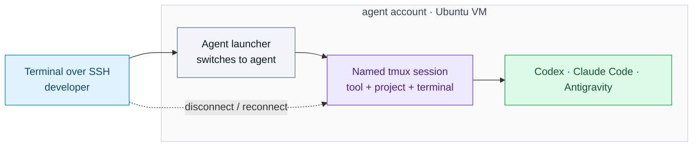

# Development VM

`Ubuntu` · `Codex` · `Ansible` · `SSH` · `tmux`

**Give coding agents room to work, and keep your attention on the task.**

Ansible configures an Ubuntu Server **26.04 LTS** development VM for coding
agents. The project is developed using Codex as its primary coding agent.
Claude Code and Antigravity are included as additional options and use the same
terminal launch workflow.

I keep this repository as a backup of my setup and share it as a reference for
anyone curious about how I work. Maintenance and testing focus on my own Ubuntu
and Codex workflow.

First create the VM and configure SSH and Git access, then run the playbook and
verify the environment.

The project manages Ubuntu configuration. Windows 11 with Hyper-V and Zed are
optional host and editor examples, outside the managed scope.

Daily project work runs as `agent`. The human operator uses `developer` to
administer Ubuntu, review changes, commit, push, and deploy.

## Start here

| Task | Guide |
|---|---|
| Create an environment | [Setup](#setup) |
| Work on a project | [Daily work](#daily-work) |
| Fix shared file permissions | [Shared project file permissions](#troubleshooting-shared-project-file-permissions) |
| Configure shared agent rules | [Agent instructions](#agent-instructions) |
| Update tools or deploy changes | [Maintenance](#maintenance) |
| Verify a deployment | [VM deployment checklist](docs/vm-deployment-checklist.md) |
| Check operational safety | [Operational safety](SAFETY.md) |

## Responsibilities

| Place or account | Responsibility |
|---|---|
| Host | Provides the VM, SSH client, and optional editor; configured separately |
| Ubuntu VM | Runs Ansible, development tools, and project applications |
| `developer` | Human administration, Git credentials, review, and publishing |
| `agent` | Coding agents, dependency installation, tests, and servers; no sudo or developer credentials |
| `/srv/projects` | Shared project files and local Git history |
| `/home/developer/dev-environment` | Protected infrastructure checkout used for deployment |

Both accounts share managed Bash, Vim, and Git preferences. Bash and Readline use
Vi editing; Vim is the default external editor. Personal Git identity stays in
ignored local variables.

## Setup

Run the steps in order. Host-specific commands are marked; after SSH is ready,
run Ubuntu commands as `developer` unless a step says otherwise.

1. Create the VM and install Ubuntu.
2. Configure SSH access from the host to the VM.
3. Clone this repository into the protected developer checkout.
4. Configure local values and run Ansible.
5. Reconnect and create a project.

**Complete when:** Ansible reports no failures and the manual deployment checks pass.

### 1. Create the VM

Download the **Ubuntu Server 26.04 LTS** ISO from [Ubuntu](https://ubuntu.com/download/server). Enable CPU virtualization in your host's BIOS/UEFI if needed.

Reference allocation: **8 vCPUs, 16 GB RAM, 200 GB disk**. Adjust to your host's capacity. The VM needs internet access, and the host must be able to reach its SSH port.

For an example host setup, see [Windows 11 / Hyper-V](docs/examples/hyper-v-host.md).
Host provisioning is manual and outside this project's scope.

### 2. Install Ubuntu

In the VM installer:

1. Install **Ubuntu Server 26.04 LTS** using the VM's virtual disk.
2. Keep DHCP networking for the initial setup.
3. Create the login account **`developer`**, with a password and administrative privileges.
4. Select **Install OpenSSH server**. This is separate from the SSH agent configured later by Ansible.
5. Complete installation, detach the ISO, and reboot into Ubuntu.

Log in through the VM console as `developer` and find the VM address:

```bash
hostname -I
```

Use that address as `VM_ADDRESS` in the next step. The address may change after a restart when using DHCP.

### 3. Connect and Configure the Host SSH Key

**On the host** (the commands below use the Windows 11 example):

1. Reuse your existing SSH key, or run `ssh-keygen -t ed25519` to create one. Accept the default path and choose a passphrase. Do not overwrite an existing key.
2. Create or edit the host's SSH config: `%USERPROFILE%\.ssh\config` in the Windows 11 example. Add the entry below, replacing `VM_ADDRESS` with the VM's address and adjusting the key path if needed:

```sshconfig
Host vm
    HostName VM_ADDRESS
    User developer
    IdentityFile ~/.ssh/id_ed25519
    IdentitiesOnly yes
```

3. Display the public key with `cat ~/.ssh/id_ed25519.pub` (also works in PowerShell). Copy the full line.

**In the VM console**, log in as `developer` and add the copied public key. Skip
this part if the Ubuntu installer already added the key.

```bash
install -d -m 700 ~/.ssh
touch ~/.ssh/authorized_keys
chmod 600 ~/.ssh/authorized_keys
vim ~/.ssh/authorized_keys
```

Paste the public key on its own line and save. Use the VM console to display the
server's SSH fingerprint:

```bash
ssh-keygen -lf /etc/ssh/ssh_host_ed25519_key.pub
```

**From the host**, run `ssh vm` and compare the displayed fingerprint with the
one from the VM console before accepting it. A prompt for the key's passphrase
is expected unless your host SSH agent already holds it. If `ssh` is unavailable
on Windows, install the **OpenSSH Client** optional feature.

Use `ssh vm` in the terminal or your editor's SSH connection. If DHCP changes the VM address, update `HostName` in the host's SSH config.

**Run the following steps inside Ubuntu as `developer`, except where explicitly marked otherwise.**

### 4. Bootstrap Ubuntu

**Required before the first Ansible run:** select `sudo.ws` instead of `sudo-rs` for this project.

```bash
sudo apt update
sudo apt install sudo
sudo update-alternatives --set sudo /usr/bin/sudo.ws
readlink -f /usr/bin/sudo
```

The last command must print **`/usr/bin/sudo.ws`**. Then install the bootstrap tools:

```bash
sudo apt install python3 ansible git
```

This switch is a manual prerequisite, not a playbook task. See the [Ubuntu sudo documentation](https://ubuntu.com/server/docs/how-to/security/user-management/#sudo-rs).

### 5. Clone This Repository

Replace `REPOSITORY_HTTPS_URL` with this repository's HTTPS clone URL. Public
repositories can be cloned anonymously. To clone over SSH, first follow
[Git hosting over SSH](#git-hosting-over-ssh-optional), then substitute the SSH
clone URL in the same command.

```bash
cd /home/developer
git clone "REPOSITORY_HTTPS_URL" dev-environment
cd dev-environment
```

### 6. Configure Local Values

```bash
cd /home/developer/dev-environment/ansible
cp -n group_vars/local.yml.example group_vars/local.yml
vim group_vars/local.yml
```

#### Required local values

| Setting | Value |
|---|---|
| `developer_git_name` | Git name used by **both accounts** |
| `developer_git_email` | Git email used by **both accounts** |

- Existing local files and values are preserved.
- `local.yml` is ignored by Git and loaded automatically. Keep personal values and credentials out of commits.

### 7. Run Ansible Manually

**Run as:** the human operator, as `developer`, from the reviewed checkout at
`/home/developer/dev-environment`. Coding agents can prepare changes and run
local checks without deploying them.

Before deployment:

- [ ] Verify SSH connectivity and keep the VM console available.
- [ ] Review the playbook and local Git identity values.

```bash
cd /home/developer/dev-environment/ansible
ansible-playbook site.yml -K
```

1. Enter the developer's sudo password.
2. Wait for **`failed=0` and `unreachable=0`** in the recap.
3. Perform the [VM deployment checklist](docs/vm-deployment-checklist.md).

**Done when:** the playbook succeeds and the manual account and workflow checks pass.

### 8. Reconnect

Close the current SSH session:

```bash
exit
```

Reconnect **from the host**:

```bash
ssh vm
```

Check that your groups include `projects`:

```bash
id -nG
```

### 9. Create Your First Project

**Inside Ubuntu as `developer`:**

```bash
mkdir /srv/projects/first-project
cd /srv/projects/first-project
git init
```

Your first project is ready. Its files live in Ubuntu and are accessible to both `developer` and `agent`.

## Daily work

### Open a project

Connect from the host with `ssh vm`, then open `/srv/projects/first-project`.
Use any editor that fits your workflow. [Zed](docs/examples/zed-editor.md) is an
optional example; editor installation and configuration are outside the project scope.

### Start agent terminals

Inside Ubuntu, as `developer`, run a launcher from the project directory:

```bash
codex-agent main
claude-agent main
agy-agent main
```



Disconnecting the terminal leaves tmux and the agent process running.

Each command starts or reconnects to a named tmux terminal running as `agent`.
The tool, project folder, and terminal name identify the session. Worktrees have
separate sessions. For another terminal, use a different name such as `review`.

| Invocation | Result |
|---|---|
| `<launcher> <terminal> [arguments...]` | Start or reconnect; tool arguments apply only when starting |
| `<launcher> list` | List this tool's sessions for the current project |
| `<launcher> help` | Show usage; `-h` and `--help` also work |
| `<launcher>` | Show sessions and usage |

Run launchers outside tmux. The names `list` and `help` are reserved.
The launcher may ask for the developer's sudo password.

### Reconnect and resume

Detach with `Ctrl+b`, then `d`, or close the SSH connection. Run the same command
to reconnect to the existing process. Two clients selecting the same terminal
share its screen and keyboard input.

Exiting the tool closes its tmux session. Sessions survive SSH and editor
disconnections, but not a VM restart. After a restart, use the tool's conversation
resume feature; for Codex, for example, run `codex-agent main resume`.
Opening the same saved conversation in separate terminals can cause a writer conflict.

Processes started outside these launchers are not migrated into tmux.
Close them normally before resuming their conversations in managed terminals.

### Troubleshooting: Codex stays on `Working`

After sleep or a network change, Codex can remain on `Working` for about five
minutes before retrying a stalled WebSocket request. Reconnecting with
`codex-agent` attaches to the existing process; it does not reset its connections.
See [upstream issue #17003](https://github.com/openai/codex/issues/17003).

Press `Esc` to interrupt. If subsequent messages still hang, try `/new` and a
short prompt. The previous conversation remains available through `resume`.
If a new conversation works but resuming the old one still hangs after a process
restart, this narrows the problem to the old conversation's context or recovery
path; it does not establish that its saved history is corrupt. Large contexts,
particularly those containing images, can also fail during WebSocket replay;
see [upstream issue #58497](https://github.com/openai/codex/issues/58497).

### Authenticate tools

All three tools use native installations under `agent`, independently of Node and npm. Complete authentication interactively
under that account, keeping login files outside the repository.

| Tool | Authentication entry point |
|---|---|
| Codex | `agent-run /home/agent/.local/bin/codex login` |
| Claude Code | `claude-agent main` and its first-run login flow |
| Antigravity | `agy-agent main` and its first-run login flow |

The Codex launcher uses `--no-daemon`: each tmux terminal runs its own Codex
backend instead of connecting to the shared background server. It also supplies
`--sandbox danger-full-access --ask-for-approval never`.
The sandbox restricts what Codex can access while it runs. With these options,
Codex can act within the permissions of the Ubuntu `agent` account without
asking for approval. Claude Code and Antigravity use their own sandbox and
approval settings. All three tools run as `agent`, which has no sudo access.

All three launchers enable Vim editing. Press `i` to enter Insert mode and
`Esc` to return to Normal mode. Launcher preferences apply to the session.
See [Codex configuration](https://learn.chatgpt.com/docs/config-file/config-reference),
[Claude Code Vim mode](https://code.claude.com/docs/en/interactive-mode#vim-editor-mode),
and [Antigravity Vim mode](https://antigravity.google/docs/cli/vim-editor-mode/).

### Run project commands

Inside Ubuntu, as `developer`, from the project directory:

```bash
agent-run npm ci
agent-run npm test
agent-run npm run dev -- --host 0.0.0.0
```

`agent-run` executes commands as `agent`, with Node loaded and the project
directory preserved. Without arguments it opens an interactive shell.
Install system libraries separately as `developer` with sudo; add reproducible
requirements to Ansible tasks.

For host browser access, bind the application to the VM interface. Reachability
depends on network and firewall settings.

### Troubleshooting: Shared project file permissions

If either account gets `Permission denied`, inspect the affected file:

```bash
file=path/to/file
stat -c '%A %U:%G %n' -- "$file"
getfacl -- "$file"
```

For a regular, non-executable file meant to be shared, correct the group with
`sudo chgrp projects -- "$file"` or, if the owner also needs correcting,
`sudo chown OWNER:projects -- "$file"` with the intended owner. After reviewing
the existing ACL entries, restore group read and write access:

```bash
sudo setfacl -m g:projects:rw -- "$file"
sudo chmod 0660 -- "$file"
```

If the problem returns, check whether the tool recreates the file with mode
`0600`. Configure it to create shared outputs with mode `0660`.

### Publish changes

As `developer`, review and commit project changes. Create the remote repository
on your Git hosting service, add its clone URL as `origin`, then push. If you use
SSH, follow [Git hosting over SSH](#git-hosting-over-ssh-optional). Keep credentials
and the developer SSH agent private to `developer`.

### Git hosting over SSH (optional)

If you clone private repositories or push changes over SSH, use a separate key
for Git hosting. Create one inside Ubuntu as `developer` if needed.

```bash
install -d -m 700 ~/.ssh
ssh-keygen -t ed25519 -f ~/.ssh/id_ed25519_git
```

Choose a passphrase and register the public key with your Git hosting service.
Keep the private key on the VM. If you already have a key for the service, use
its path here and when loading it after reconnecting.

Add an entry to `~/.ssh/config`. Replace `GIT_HOST` and `GIT_USER` with the
hostname and SSH username from the repository's SSH clone URL.

```sshconfig
Host GIT_HOST
    User GIT_USER
    IdentityFile ~/.ssh/id_ed25519_git
    IdentitiesOnly yes
```

Test authentication with `ssh -T GIT_HOST`, substituting the same hostname.
Check the response against your provider's SSH instructions. Some services
authenticate successfully and still return a nonzero exit status because they
do not offer an interactive shell. Enter the key passphrase if prompted.

After running the playbook and reconnecting, load your key into the configured
SSH agent without `sudo`.

```bash
ssh-add ~/.ssh/id_ed25519_git
ssh-add -l
```

Enter its passphrase once. Other developer terminals share the loaded key. Load it again after an agent restart or reboot. Ansible does not store its passphrase or unlock it.

## Agent instructions

The playbook installs one shared instruction file and one documentation skill for
`agent`. Tool-specific paths link to these shared sources, so all three tools use
the same documentation rules across projects.

| Tool | Global instructions | Skill directory |
|---|---|---|
| Codex | `~/.codex/AGENTS.md` | `~/.agents/skills/writing-documentation` |
| Claude Code | `~/.claude/CLAUDE.md` | `~/.claude/skills/writing-documentation` |
| Antigravity | `~/.gemini/AGENTS.md` | `~/.gemini/config/skills/writing-documentation` |

Maintain [the global rule](ansible/files/AGENTS.md) and
[the documentation skill](skills/writing-documentation/SKILL.md) in this repo.
The deployed shared instruction file is `~/.agents/AGENTS.md`.
Project instructions can refine the global rules.

Deploy through the normal playbook procedure, then start new agent sessions.
Existing regular files at symlink destinations cause the playbook to stop.
Back up and review conflicts as `agent`; move generic rules into the repository
source and retain personal settings in private tool configuration. Move conflicting
files aside before rerunning the playbook as `developer`.

Custom Codex homes and instruction overrides are not managed. See
[Claude Code instructions](https://code.claude.com/docs/en/memory),
[Claude Code skills](https://code.claude.com/docs/en/skills), and
[Antigravity discovery](https://antigravity.google/docs/customization-discovery).

## Validation

From this repository, run checks without deploying:

```bash
python3 -m unittest discover -s tests
```

The checks validate configuration, launcher arguments, account privileges, and
real tmux reconnect behavior using harmless stand-ins for all three agents.
The reconnect test requires tmux. Checks do not change services or deploy Ansible.

After deployment, follow [VM deployment checklist](docs/vm-deployment-checklist.md) and, if used, the optional
[Windows 11 host example](docs/examples/hyper-v-host.md). Verify each tool starts and reads the shared documentation skill.
**Deployment to a reference VM remains unverified.**

## Maintenance

### Change configuration

| Source | Purpose |
|---|---|
| `ansible/site.yml` | Playbook entry point and task order |
| `ansible/tasks/` | Ubuntu accounts, tools, and reproducible configuration |
| `ansible/files/` | Launchers, helpers, and shared instruction source |
| `skills/` | Locally maintained reusable skills |
| `ansible/group_vars/local.yml.example` | Generic local configuration template |
| `ansible/group_vars/local.yml` | Ignored personal values |

1. Edit, test, and commit changes on `development` in the shared checkout.
2. As `developer`, push `development` to your Git hosting service.
3. Review and merge `development` into `main` on the hosting service.
4. As `developer`, pull `main` in the protected checkout at
   `/home/developer/dev-environment`.
5. Run the playbook from the protected checkout and verify the deployment.

### Update tools

Inside Ubuntu, as `developer`, from the reviewed protected checkout:

```bash
cd /home/developer/dev-environment/ansible
ansible-playbook site.yml -K
```

The playbook updates NVM, the latest Node.js 24 LTS release, and native Codex CLI from upstream.
Codex uses the [official standalone installer](https://developers.openai.com/codex/cli).
Antigravity and Claude Code are installed only when missing and use their upstream
auto-updaters. See [Claude Code setup](https://code.claude.com/docs/en/setup).

After a successful run, check versions:

```bash
agent-run node --version
agent-run /home/agent/.local/bin/codex --version
agent-run /home/agent/.local/bin/agy --version
agent-run /home/agent/.local/bin/claude --version
```

Restart CLI processes to use updates. Reconnecting to tmux preserves the running
process and its existing version. Project dependencies and OS packages require
separate maintenance. Fresh installations may select newer upstream releases,
while Node.js stays on major version 24; repeated runs do not guarantee identical versions.

## Security and limitations

### Accounts and credentials

The protected developer home has mode `0700`. Repository credentials belong only
to `developer`; both accounts share project files and Git history and commit with
the same configured identity.

**Accepted risk:** agent-controlled Git hooks and configuration can execute as
`developer` during human Git operations and use its credentials and network.

Keep production credentials outside the VM and configure independent recovery
and service-side permissions. Use the [operational safety checklists](SAFETY.md) for operational checks.

### Network

The VM uses ordinary NAT, unrestricted internet access, and system DNS. The
playbook does not manage firewalls, domain filters, or additional network isolation.
NAT does not isolate the host or LAN from reachable guest code. Workstation and
network protection are separate responsibilities.

### Manual responsibilities

The playbook manages Ubuntu after bootstrap. These tasks remain manual:

- Hypervisor installation, VM provisioning, and virtual disks.
- Host networking, firewall rules, and workstation security.
- Ubuntu installation and initial SSH access to the VM.
- Git hosting authentication and key unlocking when using SSH for Git.
- Host editor installation and configuration.
- Agent tool authentication, backup, recovery, and disaster recovery.

A fresh workstation cannot be recreated from this repository alone.
